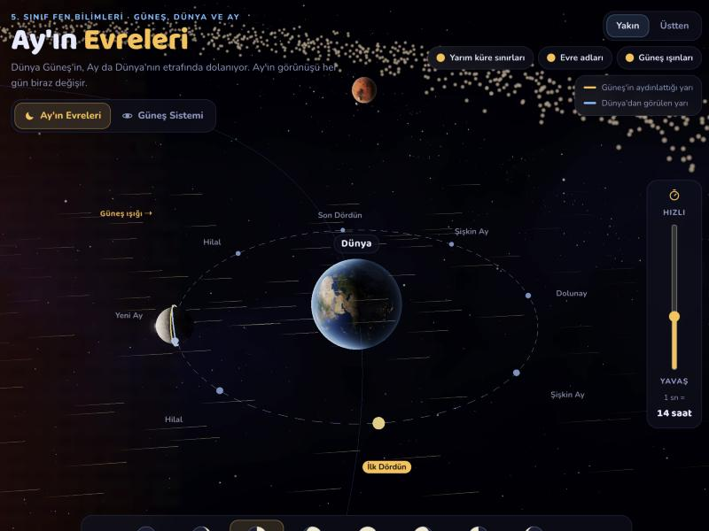
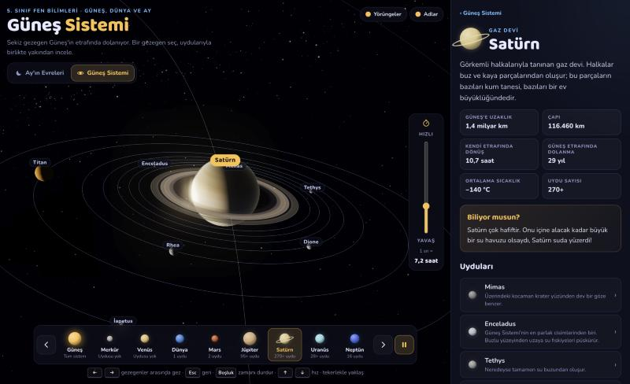

# Ay'ın Evreleri ve Güneş Sistemi

5\. sınıf Fen Bilimleri "Güneş, Dünya ve Ay" ünitesi için hazırlanmış, tarayıcıda çalışan 3B ders aracı.
Three.js ile yapıldı; kurulum gerektirmez, tek bir HTML dosyası ve dokulardan oluşur.

**Canlı:** https://vevona.github.io/ay-evreleri/ · https://demo.vevona.com/ay-evreleri/



## Neler var?

**Ay'ın Evreleri**
- Dünya Güneş'in, Ay da Dünya'nın etrafında dolanır; Dünya kendi etrafında döner. Hepsi tek bir zaman saatine bağlıdır, oranlar gerçektir.
- 8 evre (Yeni Ay, Hilal, İlk Dördün, Şişkin Ay, Dolunay, Şişkin Ay, Son Dördün, Hilal) çocuk diliyle açıklanır.
- "Dünya'dan bakınca" penceresi Ay'ın o anki görünüşünü gösterir (Kuzey Yarım Küre).
- Güneş'in aydınlattığı yarı ile Dünya'dan görülen yarının sınırları, Güneş ışınları ve evre adları açılıp kapatılabilir.

**Güneş Sistemi**
- 8 gezegen, Asteroit Kuşağı ve 21 büyük uydu.
- Bir gezegen seçince kamera ona uçar; uyduları yörüngeleriyle görünür. Uyduya tıklayınca yakından izlenir.
- Her gezegen ve uydu için bilgi kartı: uzaklık, çap, gün ve yıl uzunluğu, sıcaklık, uydu sayısı, "Biliyor musun?".
- Satürn'ün halkaları, Uranüs'ün yan yatmış ekseni, Triton'un ters yönde dolanması gibi gerçek ayrıntılar.



## Kullanım

| Tuş | Ay'ın Evreleri | Güneş Sistemi |
| --- | --- | --- |
| `←` `→` | Evreler arasında gez | Gezegenler arasında gez |
| `Boşluk` | Zamanı akıt / durdur | Zamanı durdur / akıt |
| `↑` `↓` | Zamanın hızı | Zamanın hızı |
| `Esc` | | Bir üst görünüme dön |

Fareyle sürükleyerek döndürün, tekerlekle yaklaşın. Sağdaki dikey çubuk zamanın hızını ayarlar
("1 sn = 14 saat" gibi); çift tıklayınca varsayılan hıza döner.

`#gunes-sistemi` adresi uygulamayı doğrudan Güneş Sistemi bölümüyle açar.

## Kendi bilgisayarında ya da sitende çalıştırma

Dosyalar doğrudan bir web sunucusundan yayınlanabilir. Yerelde denemek için:

```bash
python3 -m http.server 8000
```

Ardından http://localhost:8000 adresini açın. (Dokular `file://` ile açıldığında tarayıcı tarafından engellenebilir.)

Kendi sitenize koymak için `index.html` ile `textures/` klasörünü aynı klasöre yüklemeniz yeterli.
Three.js ve yazı tipleri CDN'den yüklenir, bu yüzden internet bağlantısı gerekir.

## Katkı

Hata bildirimi, öneri ve geliştirmeler için issue ya da pull request açabilirsiniz.
Metinler 5. sınıf öğrencilerine göre sade tutulmuştur; bilimsel bir yanlış görürseniz lütfen bildirin.

## Lisans

- **Kod:** [MIT](LICENSE) — dilediğiniz gibi kullanabilir, değiştirebilir ve dağıtabilirsiniz.
- **Dokular:** [Solar System Scope](https://www.solarsystemscope.com/textures/), [CC BY 4.0](https://creativecommons.org/licenses/by/4.0/).
  Dağıtırken kaynak gösterilmelidir. Ayrıntı: [textures/README.md](textures/README.md).
  Bazı uydu yüzeyleri (İo, Europa, Titan, Triton, İapetus) ve arka plandaki bulutsu kodla üretilir.

---

### English

An interactive 3D lesson (Three.js) for 5th graders, in Turkish: the phases of the Moon with an
"as seen from Earth" view, and the Solar System with all 8 planets and 21 major moons.
Single HTML file, no build step. Code is MIT licensed; textures are by Solar System Scope (CC BY 4.0).
